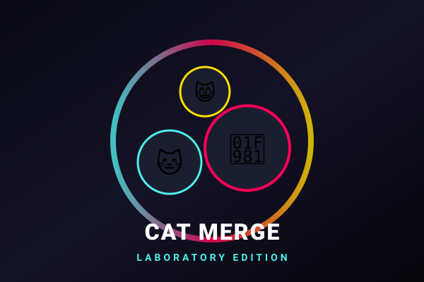

# Suika Merge Arcade Hub 🧪🐱

A browser gaming site and arcade portal for **Suika Merge** games, featuring high-performance Position-Based Dynamics (PBD) physics, multiple container shapes, sound effects, and extensible game themes.



---

## 🎮 Included Games & Themes

| Game | Category | Status | Highlights |
| :--- | :--- | :--- | :--- |
| **Cat Merge: Laboratory** | Memes / Lab | **Playable Now** | 14 progressive meme cat tiers, authentic MP3 sound effects, 3 container shapes |
| **Suika Classic: Fruit Lab** | Classic | **Playable Now** | 11 fruit tiers from Cherries up to Giant Watermelon with procedural badges |
| **Cosmic Merge: Solar Odyssey** | Sci-Fi | Coming Soon | Stellar fusion from asteroids to supermassive black holes |
| **Capybara Merge: Zen Water Lab** | Chill | Coming Soon | Cozy hot spring wildlife with buoyancy physics |
| **Doge & Memes: To The Moon** | Memes | Coming Soon | Volatile moon rocket physics with meme soundboard |

---

## 🧪 Container Shapes

Players can customize their physics challenge container before dropping items:

1. **🧪 Flask Container**: Clean white vertical neck connecting into an animated glowing RGB rainbow circular chamber. Demands precision aim down the vertical neck.
2. **📦 Box Container**: Arcade open-top rectangular crate with rounded bottom corners and wide dropping range.
3. **⬡ Hexagon Container**: Cyber funnel with sloped sliding walls that guide items inward for rapid chain-reaction merges.

---

## ⚡ Physics Engine Highlights

- **Position-Based Dynamics (PBD)**: 8 sub-steps per frame guaranteeing zero resting overlap under continuous gravity.
- **Instant Merge Detection**: Pairs same-level touching items before integration, preventing repulsion bounce.
- **Rotational & Angular Velocity**: Realistic rolling spin with clamping to avoid pinwheel anomalies.
- **Fluid Stir Vortex**: Stir button (`🌀` or `S` key) unleashes a fluid vortex impulse to unstick trapped items.
- **Overflow Danger Monitor**: 3-second countdown with visual warnings when items rest above the danger threshold.

---

## ⌨️ Controls

- **Mouse / Touch Drag**: Move dropper left and right across the container aperture.
- **Click / Release Touch**: Drop item immediately into the container.
- **A / D or Left / Right Arrows**: Move dropper smoothly.
- **Space or Down Arrow**: Drop item immediately.
- **S Key**: Stir / shake container vortex.
- **P Key or Escape**: Open in-game Settings / Pause menu.

---

## 🚀 Running the Project

### Option 1: Direct Static Hosting (Zero Install)
The portal uses modern native ES modules and requires zero build steps:
```bash
# Using Python built-in server:
python -m http.server 3000

# Or using npx serve:
npx serve .
```
Then open `http://localhost:3000` in any web browser.

### Option 2: Vite Development Server
```bash
npm install
npm run dev
```

### Option 3: Production Build
```bash
npm run build
```
Generates a minified, optimized production bundle inside `dist/`.

---

## 📁 Project Architecture

```
Suika-Merge/
├── index.html                   # Gaming Portal & In-Game Single Page App
├── package.json                 # Project scripts (dev, build, preview)
├── vite.config.js               # Vite configuration
├── README.md                    # Project documentation
├── public/
│   ├── favicon.svg              # Portal icon
│   └── assets/
│       ├── cats/                # 14 circular-masked Cat Meme PNGs (ball_0.png .. ball_13.png)
│       ├── sounds/              # 14 normalized MP3 sounds (level_0.mp3 .. level_13.mp3)
│       └── covers/              # Vector SVG game catalog cover art
└── src/
    ├── styles/
    │   ├── main.css             # Cyberpunk / Arcade portal styling
    │   └── game.css             # Responsive game canvas & HUD styling
    ├── portal/
    │   ├── catalog.js           # Game catalog data & category filtering
    │   └── leaderboard.js       # Player ranking & persistent high score tracking
    ├── engine/
    │   ├── Vector2D.js          # Vector math operations
    │   ├── Ball.js              # Rigid circle body with exponential radius scaling
    │   ├── GameContainer.js     # Container interface & factory
    │   ├── FlaskContainer.js    # White vertical neck + glowing RGB rainbow chamber
    │   ├── BoxContainer.js      # Rectangular U-shaped arcade crate
    │   ├── HexagonContainer.js  # Cyber funnel with angled sliding walls
    │   ├── PhysicsEngine.js     # 8-substep Position-Based Dynamics physics engine
    │   ├── SoundManager.js      # Web Audio API + HTML5 Audio soundboard
    │   ├── ParticleSystem.js    # Sparkle bursts, shockwaves, floating score text, screen shake
    │   ├── GameEngine.js        # Game state, drop timers, combos, danger monitor
    │   └── GameCanvas.js        # 60-120 FPS hardware-accelerated Canvas renderer
    ├── games/
    │   ├── catMergeTheme.js     # Cat Merge theme configuration & asset bindings
    │   └── fruitMergeTheme.js   # Classic Suika Fruit Merge theme configuration
    └── main.js                  # Application bootstrap and routing
```
